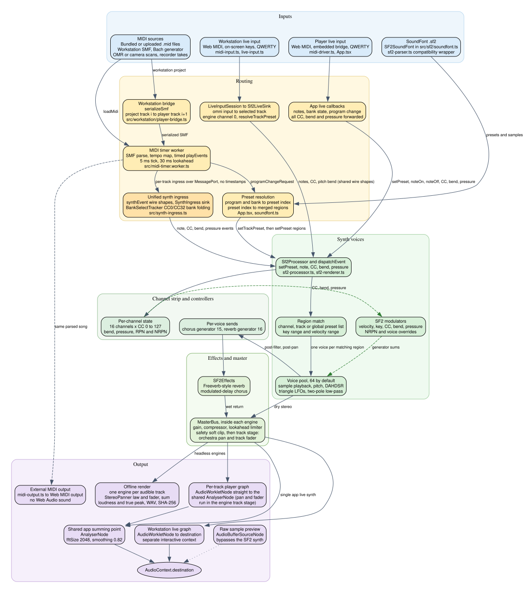
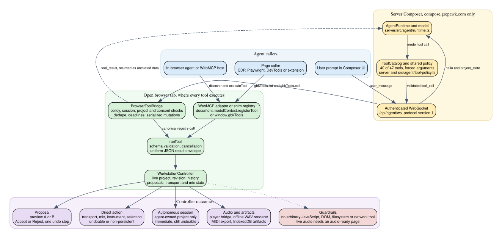

## GBK: an agentic music composer

GBK is a music workstation that AI agents compose in. Agents work through the
WebMCP tools the page registers (47 of them: notes, tracks, instruments,
arrangement, rendering) and through the server-hosted Composer at
<https://compose.grepawk.com>, which runs the model loop while the browser
executes the tools. Songs made this way are shared, forked and browsed on the
Composer's Explore page.

Underneath is the engine the agents play: a custom SoundFont2 synth in an
AudioWorklet, MIDI file playback and live input, and offline WAV rendering.
The explorer UI for SF2 data and MIDI files is the manual side of the same
workstation.

## GBK Composer for ChatGPT

GBK Composer is also a ChatGPT plugin and a remote MCP server (`https://compose.grepawk.com/mcp`, no auth required).
Describe a piece in chat and GBK writes it as editable MIDI. You can then revise one passage at a time (revision-safe
edits), view it in an in-chat piano-roll player, and render WAV + MIDI. Rendering happens in your browser (player
or Studio) or headlessly on GBK's server for clients without a browser. New compositions are private and need no
account; optional Google/GitHub sign-in lets you claim them.

- Landing page and install notes: <https://compose.grepawk.com/chatgpt>
- Demo gallery (engine-made pieces with audio, piano roll, and downloads): <https://compose.grepawk.com/chatgpt/gallery>
- Plugin package: [`plugins/gbk-composer/`](plugins/gbk-composer/). Launch docs: [`docs/launch/`](docs/launch/).

## High-Level Modules

### Master output

All audio is mastered inside the SF2 engine itself (`src/sf2/master-bus.ts`): gain, a
stereo-linked compressor, a lookahead limiter and a safety soft clip, after the voices and
effects. There is no separate app dynamics stage. The Winamp volume knob maps to the engines'
`masterGainDb`; per-track CC7/CC10/CC11 knobs act through the SF2 2.01 default modulators.
The stage adds 1.5 ms of latency and can be bypassed with `engine.masterDynamicsEnabled = false`
or tuned with `engine.master.setParams({...})`. Full detail: [Audio path in detail](#audio-path-in-detail).

### MIDI clock follower demo

`midi-clock.html` is a standalone demo that follows MIDI Clock (F8/FA/FB/FC) from Web MIDI or a
built-in synthetic source and schedules a click on the audio clock. See
[docs/midi-clock-follower.md](docs/midi-clock-follower.md) and
[docs/midi-clock-experiment.md](docs/midi-clock-experiment.md) (`npm run experiment:midi-clock`).

### Synth and MIDI modules

- `src/App.tsx`: app shell, global audio infrastructure (`AudioContext`, `AnalyserNode`), SF2
  loading, live MIDI input and keyboard triggers.
- `src/midireader.tsx`: MIDI explorer UI; creates one worklet synth node per track and owns the
  player side of the worker protocol.
- `src/midi-timer.worker.ts`: worker-thread MIDI parser, playback clock and event dispatch to the
  per-track worklet ports.
- `src/sf2-processor.ts`: AudioWorklet processor running one `Sf2SynthEngine` per node.
- `sf2-parser.ts`: SF2 file parser and preset region builder.
- `src/sf2-renderer.ts` + `src/sf2/*`: `Sf2SynthEngine`, the SoundFont 2.01 synthesis model,
  ported from sf2player-swift (there is no legacy mode). Coverage is in
  [docs/SF2_COMPLIANCE.md](docs/SF2_COMPLIANCE.md) (80 pass, 3 n/a, each row backed by
  `test/sf2-compliance-*.test.ts`); cross-engine parity against the Swift engine runs with
  `SF2_PARITY_SWIFT_BIN=… npm test`.
- `src/midi-driver.ts`: Web MIDI input handling for live controllers (note, bank/program,
  control change, pitch bend and pressure callbacks).

## Runtime Data Flow

In short: `App.tsx` loads the SF2 and caches preset regions; `midireader.tsx` hands MIDI bytes to
the timer worker, which parses and schedules them; per-track worklet nodes render the audio;
program changes are resolved on the main thread and returned to the worker as regions; live
MIDI/keyboard input plays the main synth node directly. The step-by-step version is
[Audio path in detail](#audio-path-in-detail) below.

## Worker Protocol (Main <-> Worker)

- Main -> Worker: `loadMidi` (transferable `ArrayBuffer`), `attachPorts` (per-track ports),
  `play` / `pause` / `seek`, `setTrackPreset` (resolved regions).
- Worker -> Main: `songLoaded`, `tick`, `paused`, `ended`, `programChangeRequest`, `error`.

## Audio path in detail

GBK uses one synthesis model, `Sf2SynthEngine` in `src/sf2-renderer.ts`, through several different
transports and Web Audio graphs. The current tree uses the `.ts` and `.tsx` modules named in this
section. A few module labels in the older overview predate that rename.



*Figure 1: GBK audio and event path. The Graphviz source is [docs/audio-path.dot](docs/audio-path.dot).
Dashed green edges are controller and modulator influence inside the engine. The standalone MIDI Clock
click demo is a separate path and is not part of this SF2 chart.*

### Event sources and routing

#### File and workstation playback

The player path is the shared path for songs and workstation projects:

- Bundled files from `public/static/midi-manifest.json`, uploaded `.mid` or `.midi` files, Bach
  generator output, sheet-music scans and recorder output all become SMF bytes and enter the player
  load path in `src/midireader.tsx`.
- The workstation does not own a second playback engine. `WorkstationController` state is serialized
  by `serializeSmf(...)` in `src/workstation/smf.ts` and handed to the player by
  `src/workstation/player-bridge.ts`. Project track `i` maps to player track `i + 1`; player track 0
  is the conductor track.
- Sheet music has two producers. `src/sheet-cam.tsx` uses `transcribePhotoWithOmr(...)` in
  `src/omr-sheet-bridge.ts` when the homr models are available; otherwise it uses the built-in reader
  in `src/sheet-music-reader.ts`. Both return SMF bytes.
- The recorder path uses `src/MidiRecorderUI.tsx`, `src/midi-driver.ts` and `src/midi-recorder.ts`.
  `recorderEventsToSmf(...)` in `src/workstation/recording.ts` converts a recorded take to a format 0
  SMF at 480 PPQ and 120 BPM.
- `parseMidiBuffer(...)` in `src/midi-timer.worker.ts` parses each SMF track, builds one global tempo
  map, and converts ticks to seconds. SMPTE time division is rejected. CC0 and CC32 are tracked per
  channel and folded into the bank of the following program event by `BankSelectTracker` in
  `src/synth-ingress.ts`, the one bank-folding implementation every adapter shares (the raw-MIDI
  handler in `src/midi-driver.ts` uses the same tracker). Other timed note, CC, program, pitch-bend
  and pressure events keep their MIDI channel.
- Playback uses `setInterval(runTick, 5)` and a 30 ms lookahead. Events are posted to the transferred
  `MessagePort` for their player track through that track's unified ingress (`SynthIngress` in
  `src/synth-ingress.ts`: one definition of the note, CC, bend, pressure and preset wire shapes for
  the scheduler, the workstation live sink and the player live handlers), without an audio
  timestamp, so the worklet applies an event when it receives it. Live file playback is therefore
  not sample-accurate. The offline renderer is frame-accurate.
- A program event does not directly select worklet regions unless a track override is active. The
  worker pauses that track's dispatch, emits `programChangeRequest` to the main thread, and waits.
  The main thread resolves program and bank to a preset index, obtains regions, and returns
  `setTrackPreset`; the worker forwards `{ type: "setPreset", regions }` to the track port.
- Pause, stop and seek call `stopNotes()`: a note-off for every active `(channel, note)` pair, then
  CC64 = 0 and CC66 = 0 on every channel used by the track. This prevents pedal-held voices from
  hanging after the transport moves.
- Play and seek rebuild state with `controllerStateAt(...)` in
  `src/workstation/controller-events.ts`: CC121 on each used channel, the mix base CC7, CC10 and
  CC11, RPN and NRPN events in their original order, the last value of each other CC, then the last
  pitch bend, channel pressure and poly pressure values. Mode messages CC120, CC121 and CC123 from
  the file are not refired as authored state.

External MIDI output is a side path, not a Web Audio path. `buildMidiSendEvents(...)` in
`src/midi-output.ts` converts the parsed song to timestamped raw MIDI bytes. At a nonzero start it
first sends bank and program state and controller state, then the scheduled events. Stop sends
CC64 = 0, CC120 = 0 and CC123 = 0 on all 16 channels. This path drives an external device and makes
no sound inside GBK.

#### Workstation live input

The workstation keyboard has a dedicated low-latency graph:

- `LiveKeyboard.tsx` creates one page-level rig from `MidiInputManager`, `LiveInputSession` and
  `Sf2LiveSink`. `MidiInputManager` in `src/workstation/midi-input.ts` requests Web MIDI with
  `{ sysex: false }`, supports device selection and hot-plug, and can listen to one selected input or
  all inputs. On-screen keys and computer keys call the same session directly.
- `LiveInputSession.handleMidi(...)` is omni: the incoming channel is ignored and the note is routed
  to the selected workstation track. `parseMidiMessage(...)` in `src/workstation/live-input.ts`
  recognizes note on, note off, CC and pitch bend. Program change and pressure parse as `other` and
  are not forwarded by this session.
- CC120 and CC123 are treated as a panic. The session releases its active notes and the sink sends
  CC64 = 0 followed by CC123. Other CCs are forwarded to the sink.
- `Sf2LiveSink` in `src/workstation/live-sink.ts` resolves the selected track with
  `resolveTrackPreset(...)`, the same resolver used by the offline renderer, and always posts on
  engine channel 0.
- When the session is armed and the transport is playing, notes, CCs and bends are recorded. Stop or
  pause commits them as one undoable `WorkstationController.edit(...)` with `addNotes`, `setCC` and
  `addPitchBends` operations. It is a MIDI take, not an audio recording.

#### Player live input

The older player and SF2 Explorer live path is narrower:

- `createMidiDriver(...)` in `src/midi-driver.ts` calls
  `navigator.requestMIDIAccess({ sysex: true })`. `src/external-midi-bridge.ts` can feed raw MIDI
  from a parent frame into the same message handler, and QWERTY handling in `src/App.tsx` calls the
  same note functions.
- The handler decodes note on and note off, control changes, pitch bend, and channel and poly
  pressure. CC0 and CC32 still fold into the bank of a following program change, and every CC is
  also forwarded as a `controlChange` event. CC, bend and pressure events are posted to the worklet
  as `controlChange`, `pitchBend`, `channelPressure` and `polyPressure` messages, so they shape the
  sounding preset through the engine's normal per-channel controller state.
- A program change updates the selected preset. The next note-on posts `setPreset` with that preset's
  regions and then `noteOn`. The hardware channel is not passed in the worklet messages, so this
  path uses engine channel 0 for notes and for the forwarded CC, bend and pressure state alike.
- Raw sample preview is an exception. `App.playRawSample(...)` builds a mono `AudioBuffer` and plays
  it through an `AudioBufferSourceNode` connected directly to `ctx.destination`. It bypasses the SF2
  engine, effects, master bus and analyser.

### SoundFont regions and voice rendering

`sf2-parser.ts` at the repo root is a compatibility wrapper over `SF2SoundFont` in
`src/sf2/soundfont.ts`. The player uses `parseSF2(...)`; `src/audio/soundfont-loader.ts` uses
`SF2SoundFont` directly for headless rendering and the workstation live sink.

- `SF2SoundFont.resolvePresetIndex(program, bank)` tries the exact bank and program, then bank 0 with
  the same program, then any bank with the same program.
- `regionList(presetIndex)` builds the merged SoundFont 2.01 regions for a preset from preset and
  instrument zones, with generator clamping and modulator merging from `src/sf2/soundfont.ts` and
  `src/sf2/modulator.ts`.
- Preset selection differs by entry point. The player resolves a preset on the main thread and sends
  regions. The direct engine `programChange` path uses stored CC0 as the bank, except channel index
  9 is forced to bank 128. `resolveInstrument(...)` in `src/audio/soundfont-loader.ts` uses bank MSB,
  records a warning when bank LSB would have mattered, and forces MIDI channel 10 to bank 128.

`Sf2Processor` in `src/sf2-processor.ts` owns one `Sf2SynthEngine` at the worklet sample rate.
`setOfflineTracks` installs track states and raises the voice limit to at least 64.
`setMasterGainDb` sets the engine master gain; `setTrackPan` and `setTrackFader` set the engine's
track-stage pan and fader. `setSequence` stores a scheduled event list. Every other port message
goes to `engine.dispatchEvent(msg)`, and `process(...)` calls `engine.renderScheduled(...)` for
each audio quantum.

At note-on:

1. The engine chooses a channel-specific preset list before a track list, and a track list before the
   global list.
2. It filters regions by key range and velocity range. One voice is created for every matching
   region, so layers and splits sound together.
3. A region with an exclusive class fast-releases matching voices from the same preset list and
   channel. The fast-release time is 0.005 s.
4. The default voice pool is 64 voices. When it is full, `ensurePolyphony()` removes the quietest
   voice, ranked by volume-envelope level times base gain.
5. Key-number and velocity substitution generators are applied before the voice parameters are
   calculated.

Sample playback uses linear interpolation. Separate left and right sample data are used when the
region has them; otherwise the left data feed both channels. SF2 sample modes 1 and 3 loop, and
mode 3 continues into the release tail after key-off. The base rate combines key tracking around the
root key, `scaleTuning`, coarse and fine tuning, sample-rate conversion, and modulator pitch offsets.

Each voice has separate volume and modulation DAHDSR envelopes. Volume-envelope attack is linear in
level, and decay and release use a constant dB per second shape ending at 96 dB attenuation.
Modulation-envelope attack is convex, and its decay and release are linear. Both envelopes accept
key-number-to-hold and key-number-to-decay terms. The modulation and vibrato LFOs are triangle waves;
voice LFO frequency is clamped to 0.001 to 100 Hz.

The per-voice filter is a two-pole RBJ low-pass filter with shared coefficients and separate left
and right state. Its cutoff starts with the zone value and then receives modulation-envelope,
modulation-LFO and modulator contributions. The filter is bypassed when Q is at or below zero and
the computed cutoff is at or above `min(20000, 0.45 * sampleRate)` Hz.

For each frame, `renderRange()` renders voices into dry stereo plus reverb and chorus send
accumulators, processes the sends through `SF2Effects`, adds the wet return to the dry frame, and
then applies the master stage.

### How MIDI CC shapes the sound

The engine stores all 128 controller values for all 16 channels in a `Uint8Array(16 * 128)`.
Power-on defaults are CC7 = 100, CC10 = 64, CC11 = 127, CC100 = 127 and CC101 = 127; other CCs start
at 0. Pitch bend starts at 8192 and pitch-wheel sensitivity starts at 2 semitones.

A `controlChange` first updates that channel state and then calls `updateChannelVoices()`, which
re-evaluates modulators and reapplies live generators to sounding voices on the channel. A CC with
no dedicated case below can therefore still change sound when a valid preset modulator uses it as a
source. Envelope times, LFO rates and delays, tuning and scale tuning are calculated at note-on;
filter, pitch depths, pan, attenuation and sends can update while a voice sounds.

The generator value for a voice is a sum with several layers:

1. The SoundFont zone supplies the base generator values.
2. SF2 NRPN offsets for the channel are added.
3. GBK voice overrides from `src/sf2/voice-overrides.ts` are added.
4. The region's modulators are evaluated from effective velocity, effective key number, the channel
   CC array, pitch wheel and pitch-wheel sensitivity, channel pressure and poly pressure.
5. The sum is clamped to the generator range in `src/sf2/geninfo.ts`.

Modulator curves are linear, concave, convex and switch; a modulator can also have an amount source
that scales its amount. Instrument global and local modulators replace identical defaults.
Preset global and local modulators add their amount to an identical instrument modulator. The
SoundFont 2.01 default set includes velocity to attenuation and filter cutoff, channel pressure and
CC1 to vibrato-LFO pitch depth, CC7 and CC11 to attenuation, CC10 to pan, CC91 to reverb send, CC93
to chorus send, and pitch wheel to pitch. SoundFont 2.04 default modulators omit the two send
defaults. For a 2.04 voice with no explicit send modulator, the engine's `sendCcModulators` extension
adds CC91 and CC93 at amount 200 into generators 16 and 15. An explicit send modulator suppresses
that extension instead of doubling the send.

Voice overrides target one generator in native units, with `add` or `set` mode and an optional
inclusive key range. They enter the same clamped accumulator as NRPN offsets and modulators.
Real-time generators can be refreshed on sounding voices. Envelope times and LFO rates remain
note-on values. Additive overrides without a key range can be exported as SF2 NRPN messages;
absolute overrides, key-ranged overrides and global effects parameters are project-only state.

| Controller or message | Behavior in this engine |
| --- | --- |
| CC0, bank select MSB | The SMF worker and the raw live-MIDI handlers fold CC0 with CC32 into the bank for the following program change. The direct engine `programChange` path reads stored CC0 as its bank, except channel 10 is forced to bank 128. CC0 is not a valid SF2 modulator source. |
| CC32, bank select LSB | Folded with CC0 by the SMF worker and raw live-MIDI handlers. The direct engine program path and the offline instrument resolver use bank MSB; the resolver warns when the LSB names a different available preset. CC32 is not a valid SF2 modulator source. |
| CC1, modulation | Default modulator source for vibrato LFO to pitch, generator 6, amount 50. It can also be used by a preset-defined modulator. |
| CC7, channel volume | Default modulator to initial attenuation, generator 48, amount 960 cB, with a concave curve. At 127 its default-modulator attenuation contribution is 0; lower values add up to 960 cB. Authored CC7 is channel automation. Workstation track volume is a separate track-stage fader inside the engine, described below. |
| CC10, pan | Default modulator to pan, generator 17, amount 1000. The result is combined with region pan and track pan, then clamped. Voice pan uses `gL = (1 - pan) * 0.5` and `gR = (1 + pan) * 0.5`. This is separate from the engine's track stage, which applies the orchestra-seating pan after the master bus (and from offline track pan). |
| CC11, expression | Default modulator to initial attenuation, generator 48, amount 960 cB, with a concave curve. It stacks with CC7 in the same generator sum. |
| CC64, sustain pedal | Values at or above 64 defer key-off. When the value crosses below 64, deferred voices release unless sostenuto is holding them. |
| CC66, sostenuto | At or above 64, voices that are key-down at that moment are marked sostenuto. Below 64, the marks clear and deferred voices can release. |
| CC67, soft pedal | Read at note-on. If it is at or above 64, the new voice receives +60 cB attenuation and -600 cents of filter cutoff. It does not retune voices that are already sounding. |
| CC71, resonance | No dedicated `controlChange` case. The value is stored per channel and can shape sound only through a valid preset modulator. The capability table labels this source as resonance. |
| CC74, brightness | No dedicated `controlChange` case. The value is stored per channel and can shape sound only through a valid preset modulator. The capability table labels this source as brightness. |
| CC91, reverb send | Modulator input to reverb send, generator 16, amount 200. CC127 adds about 19.8 percentage points on the 0 to 1000 send scale before the zone, NRPN and override values are summed and clamped. |
| CC93, chorus send | Modulator input to chorus send, generator 15, amount 200. It follows the same amount and clamping rule as CC91. |
| CC6 and CC38, data entry | For RPN 0,0, the pair sets pitch-wheel sensitivity as CC6 semitones plus CC38 cents divided by 100. For an active SF2 NRPN, CC6 combines its value with stored CC38 as a centered 14-bit value and scales it by the generator step from `nrpnScale(...)`. Changing CC38 alone does not rewrite an NRPN offset. |
| CC99 and CC98, SF2 NRPN select | CC99 = 120 activates SoundFont NRPN mode. CC98 values 0 to 99 select a generator directly; values 100, 101 and 102 add 100, 1000 and 10000 to an accumulated generator number. The generator must be below 61, have a value range, and not be `scaleTuning`. |
| CC100 and CC101, RPN select | Select the RPN. Only RPN 0,0 has a parameter implementation in this engine: pitch-wheel sensitivity through CC6 and CC38. |
| CC96 and CC97, data increment and decrement | No data increment or decrement case is implemented. The values are stored, replayed with the RPN and NRPN group on seek, and can be preset modulator sources. |
| CC120, all sound off | Kills every voice on the channel and marks it finished immediately. It does not use the release envelope. |
| CC121, reset all controllers | Clears CC1, CC2, CC4, CC64, CC65, CC66, CC67, CC68 and CC69; restores CC11, CC98, CC99, CC100 and CC101 to 127; centers pitch bend; clears channel pressure, poly pressure, NRPN offsets and sostenuto; and releases deferred voices. It does not restore CC7 or CC10, and it does not change the stored pitch-wheel sensitivity value. |
| CC122, local control | No local-control implementation was found in the engine. The value is stored, and CC122 is not a valid modulator source. |
| CC123, all notes off | Sends key-off to every key-down voice on the channel through the normal key-off path, so sustain and sostenuto deferral still apply. |
| CC124 to CC127, channel mode messages | No channel-mode implementation was found in the engine. The values are stored, and controllers at or above 120 are not valid modulator sources. |
| Other CCs | Stored per channel, scheduled, restored on seek and exported. They have no fixed destination in the engine; they change sound only when a valid SoundFont modulator uses the CC as a source. CC120 to CC127 are excluded as modulator sources, and CC33 to CC63 are also excluded as sources. |
| Pitch bend | A 14-bit channel value centered at 8192. The default pitch modulator has amount 12700 and is scaled by pitch-wheel sensitivity, which defaults to 2 semitones and is set by RPN 0,0. Bend updates sounding voices. |
| Channel pressure | Stored per channel and updates sounding voices. Its default modulator routes it to vibrato LFO pitch depth, generator 6, amount 50. |
| Poly pressure | Stored per channel and note and updates voices on that channel. It has no default destination; a preset modulator can use it. |
| Program change | In the player path, the main thread resolves bank and program to regions and sends `setPreset`. In the direct engine path, it selects the loaded region list for the channel bank and program, with channel 10 forced to bank 128. |
| Note on with velocity 0 | Treated as note-off. |
| Note-off release velocity | Preserved by the workstation SMF model and re-exported, but the SF2 engine key-off path does not use it. |

The workstation mix has three layers. Persisted track mix defaults are the base layer and are
undoable. Authored timed CC automation plays on top of the base values for pan and expression.
Temporary live overrides are not persisted. For pan and expression, an override supplies the
current base value until authored automation for that controller reaches the engine. Volume is the
exception in the current code: the workstation volume is applied as the engine's track-stage fader
`(volume / 100)^2`, after the master bus, while the CC7 base sent to the engine is held at the GM
default 100. Authored CC7 automation still enters the engine normally.

### Effects, channel strip, master bus and output

Each engine instance owns one `SF2Effects` object from `src/sf2/effects.ts`. A per-track player
engine has its own effects, and the offline renderer creates the same arrangement with one engine
per audible track.

- Reverb is a Freeverb-style stereo design with 8 lowpass-feedback comb filters and 4 series allpass
  filters per channel and a 23-sample stereo spread. The combs receive the mono sum of the panned
  send buses times 0.03. At the default `reverbLevel = 0.5`, the wet return scale is 2.7; at level
  1 it is 5.4.
- Chorus uses two quadrature-modulated delay lines with linear interpolation. The right channel has
  a quarter-cycle phase offset.
- Defaults are effects enabled, room size 0.5, damping 0.5, reverb level 0.5, chorus level 0.7,
  chorus depth 4 ms, chorus rate 0.6 Hz and chorus delay 12 ms. Comb feedback is
  `0.7 + 0.28 * roomSize`; comb damping is `0.4 * damping`.
- Project effects parameters are sent to every player track engine by the player bridge and are
  installed as a setup event in the offline render plan. The workstation live sink uses the effects
  defaults inside its own engine; the sink code applies the selected track's preset and mix, not the
  project voice overrides or project effects parameters.

The master stage in `src/sf2/master-bus.ts` runs inside each engine after voices and effect returns:

1. Master gain. The default is -3 dB and it applies even when master dynamics are disabled.
2. A stereo-linked feed-forward compressor with a -6 dBFS threshold, 4:1 ratio, 6 dB knee, 5 ms
   attack and 100 ms release. Its peak detector uses `max(|L|, |R|)`.
3. A lookahead brickwall limiter with a -0.3 dBFS ceiling, 1.5 ms default lookahead, 50 ms release
   and a preallocated maximum lookahead of 10 ms.
4. A safety soft clip that is unity below 0.9 times the ceiling and then follows a tanh knee. The
   ceiling is below 1, so engine output stays below +1.0 and -1.0.

After the master bus, each engine applies its track stage: the orchestra-seating pan (resolved
from track name, instrument name and preset name in `src/audio/orchestra-pan.ts`, applied with
that module's `stereoPanGains` matrix, the stereo-input StereoPanner law) and the track fader
(the `(volume / 100)^2` law, with mute and solo, approaching its target with the same 10 ms
one-pole the node's `setTargetAtTime` used). The stage is set with the `setTrackPan` and
`setTrackFader` worklet messages. Its defaults are identity, so offline renders are unaffected;
the offline renderer applies the same pan law and fader itself, after its engines.

The live Web Audio graphs are:

- File and workstation playback, one graph per player track:
  `AudioWorkletNode("sf2-processor")` -> `AnalyserNode` -> `AudioContext.destination`. There are
  no per-track pan or gain nodes and no summing gain node: pan and fader run in the engine's
  track stage, and the track worklets sum at the analyser's input.
- Player live input: one `AudioWorkletNode("sf2-processor")` -> `AnalyserNode` ->
  `AudioContext.destination`.
- Workstation live input: `AudioWorkletNode("sf2-processor")` -> the destination of a separate
  `AudioContext` created with `latencyHint: "interactive"`. Its fader and pan are the selected
  track's effective mix, applied by the same in-engine track stage. It does not pass through the
  app analyser.

The app volume control maps to each engine's `masterGainDb` through `volumeToMasterGainDb`; full
volume is -3 dB and zero volume is -120 dB. The shared analyser has `fftSize = 2048` and
`smoothingTimeConstant = 0.82`; `src/App.tsx` reads its time-domain and frequency arrays for the
analyser UI.

#### Offline WAV rendering

WAV export does not use the live AudioWorklet graph:

```text
Project
  -> structuredClone
  -> RenderJobManager in src/audio/render-job.ts
  -> SoundFont loader in src/audio/soundfont-loader.ts
  -> buildRenderPlan in src/audio/offline-renderer.ts
  -> one Sf2SynthEngine per audible track
  -> StereoPanner law and post-engine fader, then a sum
  -> BS.1770 loudness and true-peak measurement
  -> one whole-file gain when normalizing
  -> src/audio/wav-encoder.ts
  -> src/audio/audio-validation.ts and SHA-256
  -> artifact-store.ts, IndexedDB "gbk-render-artifacts"
```

The plan honors programs and banks, CC7, CC10, CC11, CC1, CC64, CC91 and CC93, pitch bend, pressure,
voice overrides, project effects, the tempo map and a configurable release tail. Master volume is a
live monitor level and is not baked into a render. Default normalization is loudness normalization
to -16 LUFS with a -1 dBTP cap. The `peak` mode targets -1 dBTP; `off` returns the engine mix without
the whole-file normalization gain. SysEx can be stored in a project and exported to MIDI, but it has
no effect on the SF2 render and the render plan warns about it.

## UI Layout

- Top toolbar: audio power state/control, MIDI connect + input selection.
- Tabs: `MIDI Explorer` and `SF2 Explorer`.
- Fixed right analyzer panel: time-domain and frequency-domain snapshots.

## Build & Deploy

- Dev: `npm install`, then `npm run dev`. Build: `npm run build`.
- Vite base: `/` in dev, `/gbk/` for the production build (GitHub Pages project site).
- GitHub Actions: `.github/workflows/deploy-pages.yml` builds and deploys `dist` to GitHub Pages
  on every push to `main`.
# gbk


## Workstation + WebMCP (agent tools)

GBK opens on an editable **workstation**: tick-based piano roll, CC / pitch-bend automation lanes,
transport, and an agent activity / proposal panel. The original player, playlist, SoundFont
explorer, Bach generator, sheet music and recorder live under **Player / Library** (a modal; the
audio engine stays mounted).

- Edit by hand in the piano roll and automation lanes (select, move, resize, add/delete,
  transpose, nudge, zoom); Undo/Redo share one history with agents.
- **Enable Agent Tools** registers `gbk_*` tools with WebMCP (`document.modelContext`, Chrome with
  WebMCP enabled). Agents stage *proposals*; you audition A/B and press **Accept** or **Reject**.
  Off by default; GBK works without it. Full surface: [WebMCP and agentic path in detail](#webmcp-and-agentic-path-in-detail).
- Timed CC (all 0–127), 14-bit pitch bend and pressure play, seek, loop, export to MIDI/WAV and
  MIDI-out consistently.

Docs: [architecture](docs/architecture.md) · [WebMCP tools](docs/webmcp.md) · [controller pipeline](docs/controller-pipeline.md) ·
[demo walkthrough](docs/demo-walkthrough.md).

### WebMCP and agentic path in detail

GBK's in-page agent surface is WebMCP's imperative registration API. It is not an HTTP or SSE MCP
server hosted by the app. The same `ToolDef` registry in `src/webmcp/registry.ts` can be registered
on a real browser ModelContext or on GBK's page-local shim registry.



*Figure 2: WebMCP and server Composer paths. Both end in the same browser-side `runTool(...)` and
`WorkstationController`. The Graphviz source is [docs/agent-path.dot](docs/agent-path.dot).*

#### Registration, discovery and invocation

- The **Enable Agent Tools** toggle in `src/components/workstation/AgentPanel.tsx` calls
  `registerWebMcpTools(workstation, buildAllTools(workstation))` in `src/webmcp/adapter.ts`.
- `getModelContext(...)` checks `document.modelContext` first and `navigator.modelContext` second.
  For each tool, the adapter calls `registerTool` with the name, description, JSON input schema,
  annotations and an `execute(input, { signal })` function. It does not set `exposedTo`, so the app
  does not request cross-origin exposure.
- Registration is a module-level singleton owned by one `AbortController`. A new registration or an
  HMR teardown aborts the previous set. Turning the toggle off unregisters the tools.
- Real WebMCP mode is off by default. Shim mode is on by default unless the user has unchecked it.
  The choice is persisted in `localStorage["gbk.agentTools"]`.
- In real WebMCP mode, the adapter registers the tools on the browser ModelContext and on the local
  shim registry. In shim-only mode, it registers them only locally. The shim installs
  `window.gbkTools`, with `gbkTools.mode`, `await gbkTools.list()` and
  `await gbkTools.call(name, args)`. The list returns names, descriptions, input schemas and
  annotations. A call returns the same result as the real tool's `execute(...)`.
- A WebMCP host discovers the registered tools through the ModelContext surface. A page caller can
  use the shim through CDP, Playwright `page.evaluate`, DevTools or an extension. Neither surface
  exposes a general JavaScript, DOM, filesystem or network tool.
- `execute(...)` reads live `WorkstationController` state at call time. It does not use captured
  React state.
- Adapter annotations are `readOnlyHint: tool.readOnly`, `untrustedContentHint: tool.readOnly` and
  `consequentialHint: false`. Read tools therefore carry both hints as true, because project names
  and metadata can come from files.
- By default, a result is JSON text. If a host advertises supported content types, supported
  non-text content can be returned with the text envelope. Unsupported content is not silently
  stringified or truncated; the result reports that it was not sent and points to the artifact and
  byte-range tools.

Every invocation goes through `runTool(...)` in `src/webmcp/tools.ts`:

1. Reject the call if the caller's `AbortSignal` is already aborted.
2. Validate the arguments against the tool schema. The schema helper sets
   `additionalProperties: false`; the validator checks types, required fields, string lengths,
   numeric ranges, array limits, enum values and nested objects.
3. Run the tool against the live controller.
4. Check the signal again.
5. Log the attempt in the controller activity log.
6. Return a uniform envelope. Success is `{ ok, projectId, revision, data, warnings }`. Failure is
   `{ ok: false, projectId, revision, warnings: [], error: { code, message, details? } }`.

There is no per-tool bearer token or sample-access token in the in-page WebMCP path. A WebMCP origin
trial token is different: it only enables the browser API for one origin, no token is committed in
this repo, and it is not a credential for calling a GBK tool.

#### Registered tools

`buildAllTools(...)` currently registers 47 tools.

**Core reads**

- `gbk_get_capabilities`: Report implemented tools, audible and stored-only CCs, effects, voice
  editing, unsupported surfaces and audio readiness.
- `gbk_get_project_summary`: Return the project name, PPQ, tempo and meter maps, counts, revision
  and pending proposals.
- `gbk_list_tracks`: List tracks with stable IDs, names, channels, mix defaults, overrides, note
  counts and programs.
- `gbk_get_notes`: Query notes by range, track and pitch, with pagination up to 500 per page.
- `gbk_get_cc_events`: Return timed CC events in a range plus the effective controller values at
  the range start.
- `gbk_get_selection`: Return the shared UI selection and loop.
- `gbk_get_transport`: Return playback state and position in ticks, seconds and bar/beat form.
- `gbk_list_presets`: List SoundFont presets available to `gbk_set_instrument`.

**Core direct actions**

- `gbk_set_transport`: Play, pause, stop, seek or set the loop through the player bridge.
- `gbk_set_track_mix`: Set a persisted mix default, set a temporary live override or clear an
  override. It never rewrites authored CC events.
- `gbk_set_instrument`: Set a track's program and bank at tick 0 as an undoable edit.
- `gbk_select_passage`: Set the shared UI selection, and optionally the selected tracks, without
  changing the project revision.

**Proposals, history and exports**

- `gbk_propose_note_patch`: Stage note additions, removals and updates as a proposal.
- `gbk_propose_cc_patch`: Stage explicit CC points for one track and controller in replace or merge
  mode.
- `gbk_generate_cc_curve`: Generate a deterministic CC curve and stage it as a proposal.
- `gbk_propose_track_patch`: Stage track property changes or track additions.
- `gbk_preview_proposal`: Audition variant A, the original, or variant B, the candidate, for up to
  30 seconds without mutating the project. It is classified as read-only.
- `gbk_commit_proposal`: Request application of a proposal as one undoable transaction. Outside an
  autonomous session, the user must approve it.
- `gbk_discard_proposal`: Discard a pending proposal without changing the project.
- `gbk_undo`: Undo through the same history used by human edits.
- `gbk_redo`: Redo through the same history used by human edits.
- `gbk_prepare_midi_export`: Serialize the project to an SMF and offer it as a browser-local
  download.
- `gbk_prepare_wav_export`: Render the project with the headless renderer and offer a browser
  download unless `download: false`.

**Music generation and analysis**

- `gbk_analyze_passage`: Return deterministic pitch-class, range, density, interval and motif
  statistics, plus a heuristic key and heuristic cadence candidates.
- `gbk_generate_counterpoint`: Generate a heuristic species-style counterpoint line and return a
  proposal with ranked alternatives.
- `gbk_generate_fugue_section`: Generate a seeded Bach-style fugue exposition and stage it as new
  tracks.

**Project and composition-session tools**

- `gbk_create_project`: Create a new empty project and start a scoped autonomous session. The
  current project is checkpointed first unless `replaceCurrent` is true.
- `gbk_create_track`: Create one track or an atomic batch of tracks with role, bank and program,
  channel and mix defaults.
- `gbk_set_tempo_map`: Replace the tempo map from bar and beat BPM events.
- `gbk_set_time_signature_map`: Replace the meter map from bar-based numerator and denominator
  events.
- `gbk_set_song_structure`: Set non-overlapping named sections with energy values. Sections persist,
  export as SMF markers and drive arrangement dynamics.
- `gbk_get_composition_session`: Report the autonomous session's project and expiry, and whether
  edits to the current project apply without approval.

**Arrangement tools**

- `gbk_generate_arrangement`: Generate a complete seeded multi-track arrangement with notes and
  CC11, CC1 and CC91 material.
- `gbk_generate_part`: Generate melody, bass, walking bass, chords, arpeggio, Alberti pattern,
  drums or counterpoint for one track and range.
- `gbk_transform_notes`: Transpose, invert, retrograde, repeat or sequence, quantize, humanize,
  articulate, apply phrase dynamics or vary notes in a range.
- `gbk_orchestrate`: Copy a passage to another track with transposition and velocity scaling, folded
  into the target instrument's range.

**Sound tools**

- `gbk_get_voice_settings`: Return effective per-zone SF2 generator values in human units, effective
  reverb and chorus sends, voice overrides and global effects for a track's resolved preset.
- `gbk_propose_voice_patch`: Stage per-track SF2 generator overrides with `set`, `add` or `scale`
  mode and optional key ranges.
- `gbk_set_effects`: Stage global reverb and chorus parameters as a proposal. Despite the name, it
  does not apply the change until the proposal is committed.

**Render and artifact tools**

- `gbk_render_wav`: Render the committed project snapshot to a validated WAV headlessly. Output can
  be a stored artifact, supported inline audio or bounded inline bytes.
- `gbk_get_render_status`: Poll a render job's status, progress, errors and artifact ID. Jobs are
  page-local; artifacts persist.
- `gbk_cancel_render`: Cancel a queued or running render job. No partial artifact is saved.
- `gbk_list_render_artifacts`: List persisted WAV and MIDI artifacts with metadata, newest first.
- `gbk_get_render_artifact`: Return one artifact's metadata and a same-origin, page-local object
  URL. It does not return the audio itself.
- `gbk_read_wav_bytes`: Return a bounded base64 byte range of an artifact, at most 256 KiB per call,
  with `nextOffset`, `eof`, total size and SHA-256 verification data.
- `gbk_download_render_artifact`: Start a browser download of a saved artifact. It reports that the
  download was requested, not that the file reached disk.
- `gbk_delete_render_artifact`: Delete a saved artifact from browser storage.

#### What a call changes

Read tools read the live `WorkstationController.project` and controller state. The direct transport,
mix, instrument and selection tools call controller methods. Content and sound edits normally use
one of two paths:

- `c.propose(...)` stores an original project snapshot, a candidate project, the operations, a
  `baseRevision`, the affected range and tracks, validation warnings and a status.
  `gbk_preview_proposal` sends the original or candidate to the player-bridge preview driver.
  `gbk_commit_proposal` calls `WorkstationController.commitProposal(...)`, which rejects stale or
  non-pending proposals and checks `baseRevision` again before applying the operations as one undo
  transaction.
- Composition and arrangement tools use `agentApply(...)`. Inside a valid autonomous session, the
  operations commit immediately as one undoable edit. Outside that scope, `agentApply(...)` returns
  a proposal instead.

Outside an autonomous session, an agent commit invokes the controller's approval handler. The Agent
panel shows the proposal and the user presses **Accept** or **Reject**. A successful commit, undo
or redo bumps the revision and marks other pending proposals based on an older revision as stale.

MIDI export calls `WorkstationController.prepareMidiExport()`, which uses
`serializeSmf(project, { soundNrpn: true })`. WAV export and `gbk_render_wav` use the headless
renderer in `src/audio/offline-renderer.ts`; they do not need an `AudioContext`, a user gesture, a
mounted player or a preloaded SoundFont. Live transport and proposal preview do need an audio-ready
player driver. `WorkstationController.needDriver()` returns `AUDIO_NOT_READY` when the driver is
absent or audio is not ready, with a message that the user must click in the page to start audio and
load a SoundFont.

A shared song opened from `/s/<slug>` is read-only. `WorkstationController.loadShared(...)` gives it
a new local project ID and sets a read-only reason; mutation paths return `READ_ONLY` until the user
forks it into an editable copy.

#### Autonomous session

`gbk_create_project` with owner `agent` starts an `AutonomousSession`. The default length is 120
minutes unless `sessionMinutes` is supplied. Immediate agent edits are allowed only when all of
these are true:

- a session exists and has not expired;
- the session is active;
- the session project ID matches the target project ID;
- that project is currently loaded;
- `project.meta.owner` is `agent`.

The session ends when the user loads another project, when it expires, or when the user ends it in
the Agent panel. **Discard agent work** walks undo back to the session's `baseRevision` and then
ends the session. User-owned projects keep the proposal and Accept flow.

Common error codes from the current code include `STALE_REVISION`, `INVALID_RANGE`,
`INVALID_ARGUMENT`, `AUDIO_NOT_READY`, `USER_APPROVAL_REQUIRED`, `OPERATION_CANCELLED`,
`READ_ONLY`, `UNSUPPORTED` and `INTERNAL_ERROR`. Render calls can also return
`SOUNDFONT_FETCH_FAILED`, `SOUNDFONT_INVALID`, `INSTRUMENT_NOT_FOUND`, `EMPTY_PROJECT`,
`RENDER_TOO_LARGE`, `NON_FINITE_SAMPLES`, `WAV_INVALID`, `UNEXPECTED_SILENCE`,
`UNEXPECTED_CLIPPING`, `QUOTA_EXCEEDED`, `STORAGE_UNAVAILABLE`, `ARTIFACT_NOT_FOUND` and
`DOWNLOAD_BLOCKED`.

#### Server-hosted Composer

The Composer at `compose.grepawk.com` is a separate agentic path. It is not server-side MCP and it
does not replace WebMCP. The server runs the model loop, but the open browser tab executes every
tool against the local project.

The frontend shows the Composer only when the same-origin `/api/config` endpoint answers with JSON.
On GitHub Pages that endpoint is absent and the Composer UI stays hidden. `src/Root.tsx` provides
`/` and `/explore` for the Explore page when the Composer server is present, `/studio` for the
workstation, and `/s/<slug>` for a shared song.

The Composer flow is:

1. The user sends a prompt from the Composer UI. `BridgeClient` in `src/agent/bridge-client.ts`
   sends a `user_message` frame over a WebSocket to `/api/agent/ws`.
2. On connection, the client sends a `hello` frame with protocol version 1, a random tab ID, the
   policy-filtered tool manifest and its hash, the current project ID and revision, and an optional
   run ID to resume. It then sends `project_state` whenever the project ID or revision changes.
3. `AgentRuntime` in `server/src/agent/runtime.ts` appends the browser workstation state to the user
   message as data, not as instructions. It offers only the vetted catalog tools accepted for that
   browser session.
4. The model returns a tool call. `ToolCatalog` in `server/src/agent/tool-catalog.ts` parses the
   model arguments, merges policy-forced arguments over them, and validates the result with the same
   `validate(...)` used by WebMCP.
5. The server sends a `tool_call` frame to the browser. `BrowserToolBridge` in
   `src/agent/browser-bridge.ts` checks the shared policy, session ID, new-project consent and
   expected project ID, then executes the call through the canonical `buildAllTools(...)` registry
   and `runTool(...)`.
6. The browser returns a `tool_result`. The runtime wraps the result with `untrustedData: true`,
   compacts it to the configured result limit, and gives it to the model as tool data. The loop
   continues until the model finishes or a stop condition is reached.

A browser manifest never grants a tool by itself. During `hello`, the server reconciles it against
its own catalog. A tool is accepted only when the name is known and the JSON input schema is
identical. Accepted and rejected tool names are returned in `session_ready`.

The bridge adds its own checks and failure codes:

- a tool outside the shared Composer policy returns `TOOL_NOT_ALLOWED`;
- a call for another session returns `SESSION_MISMATCH`;
- `gbk_create_project` without the run's new-project consent returns `CONSENT_REQUIRED`;
- a non-create call for a different open project returns `PROJECT_CHANGED`;
- a repeated `(runId, callId)` returns the same result promise instead of executing twice;
- mutations and renders are serialized through one chain, while reads can run immediately;
- each call has a deadline enforced with an `AbortController`;
- non-text tool content is stripped before the result leaves the page;
- an oversized text result returns `RESULT_TOO_LARGE` instead of being truncated.

The server dispatcher in `server/src/agent/tool-dispatcher.ts` rejects duplicate call IDs in one
model response and rejects tools outside the session's allowed set. Consecutive read-class calls
can run in parallel. Reads are flushed before a mutation or render, and mutations and renders run
strictly in order.

The shared policy in `src/agent/tool-policy.ts` exposes 40 of the 47 WebMCP tools to the server
Composer. It deliberately excludes:

- `gbk_read_wav_bytes`, because it would relay media bytes through the LLM path;
- `gbk_download_render_artifact`, `gbk_prepare_midi_export` and `gbk_prepare_wav_export`, because
  downloads need a user gesture;
- `gbk_delete_render_artifact`, because it deletes user data;
- `gbk_set_transport` and `gbk_preview_proposal`, because live audio needs the user's click.

Policy also forces arguments. `gbk_create_project` is forced to `replaceCurrent: false`, so the
current project is checkpointed rather than replaced. `gbk_render_wav` is forced to
`output: "artifact"` and `download: false`.

Composer access and limits are server concerns, separate from WebMCP tool registration:

- Anyone can sign in with Google or GitHub (`/api/auth/<provider>`; a provider appears only when its
  `*_CLIENT_ID` and `*_CLIENT_SECRET` are set). Accounts live in `accounts.sqlite`. Every account has
  a daily LLM-token and render limit; accounts younger than `ACCOUNT_NEW_DAYS` get smaller limits.
  Legacy access codes (`COMPOSER_ACCESS_CODES`, `name:code`) still sign in the migrated invite users.
- The session cookie is HMAC-signed, `HttpOnly` and `SameSite=Strict`. A separate non-HttpOnly CSRF
  cookie supports double-submit checks through the `x-gbk-csrf` header.
- State-changing HTTP routes and the WebSocket upgrade check the request Origin against the
  configured allowlist. The upgrade also checks a per-IP rate limit, a live session cookie and
  whether `COMPOSER_ENABLED` is off.
- `SessionRegistry` allows one active browser tab per user. A newer tab closes the older one with
  WebSocket code 4409. `BridgeClient` reconnects with bounded exponential backoff, up to 8 attempts
  and a maximum delay of 15 seconds; close code 4401 is treated as unauthorized.
- If the browser disconnects during a run, the runtime waits for a reconnect inside the grace
  period. If a different project is open after reconnect, it does not resume the run.
- Default limits in `server/src/config.ts` are 40 tool steps per run, 1 concurrent run per user, a
  120000 ms tool timeout, 12000 characters of user input, 32000 context tokens, 4096 model output
  tokens, an 1800 second session idle timeout, a daily budget of 2000000 tokens and $5 per user, a
  $20 global daily cost budget, a 30000 ms reconnect grace period and 12000 characters of tool-result
  text returned to the model.
- The WebSocket protocol in `src/agent/protocol.ts` sets `MAX_FRAME_BYTES` to `512 * 1024` in both
  directions. `PendingCalls` tracks one resolver per call ID, enforces the deadline, and rejects
  outstanding calls on disconnect or cancellation.
- `COMPOSER_ENABLED=0` is the server off switch. The LLM API key stays in server configuration and
  is used only by the server model client; it is not a browser tool credential.

## Songs
Songs made with GBK's agent tools are published in [`songs/`](songs/) and shown at
<https://compose.grepawk.com>. Publish one with `npm run song:publish -- songs/recipes/<name>.json`; see [docs/songs.md](docs/songs.md).

## Composer (compose.grepawk.com)
A server-hosted AI Composer, with the browser as the tool executor, plus song sharing, forking and an Explore page. See [docs/compose-deploy.md](docs/compose-deploy.md).
